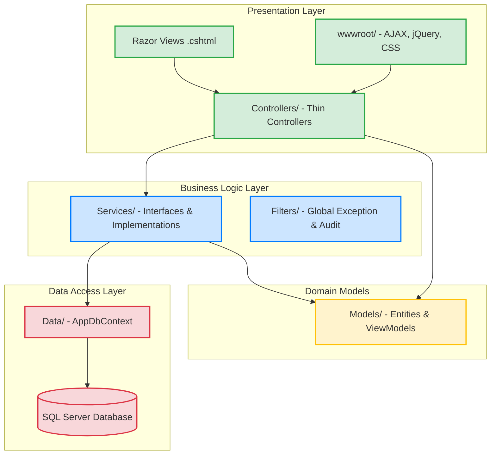
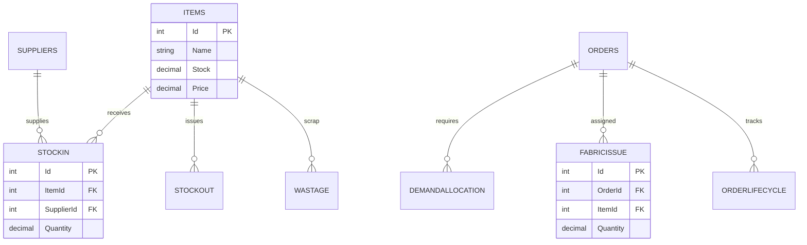
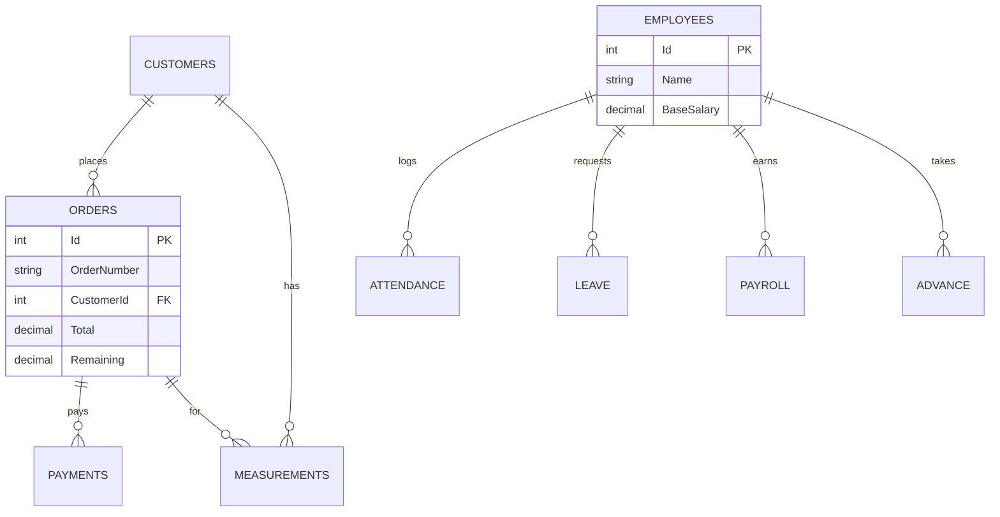

# 👗 Bhutta Boutique ERP - Tailoring & Boutique Management Suite


An enterprise-grade, comprehensive ERP system specifically architected for the **Tailoring and Boutique industry**. Built on **ASP.NET Core MVC (.NET 10)** with **Razor Views** for server-side rendering, backed by **Entity Framework Core 10** and **SQL Server**. The application features a highly responsive UI built with **Bootstrap 5** and dynamic client-side interactions via **AJAX/jQuery**. It seamlessly unifies complex workflows including Sales, Inventory, Production, HR/Payroll, and Financial Reporting into a single, cohesive platform.


---

## 🏗️ Architecture Overview

The system is designed following **Clean Architecture** principles within a single ASP.NET Core MVC project. The business logic is decoupled from the UI and Data Access layers, ensuring a highly maintainable and testable codebase.



---

## 🗄️ Database Entity-Relationship (ER) Diagrams

The database is highly normalized and designed using **Entity Framework Core (Code-First)**. To keep the diagrams readable, the model is categorized into logical modules.

### 1. Inventory & Production Module
Tracks item stock, supplier deliveries, fabric issuing, and order lifecycles.



### 2. Services, Customers & HR Module
Manages customer orders, tailoring measurements, employee attendance, and payroll.



---

## 🛡️ Security, Policies, and Audit Trails

### Authentication & Authorization
The application is secured using **Cookie-Based Authentication** and strict **Role-Based Access Control (RBAC)**.

*   **RBAC Enforcement:** Controllers are decorated with `[Authorize(Roles="...")]`. For example, only the `Admin` and `HRManager` roles can access the Payroll module.
*   **Password Security:** User passwords are securely hashed using **SHA256** before being stored in the database. No plain text passwords exist in the system.
*   **Session Management:** Uses `.NET Core Session` with HttpOnly cookies to manage user logins and prevent XSS attacks.

### Automated Auditing Mechanism
The system features an automated, transactional auditing design at the database level:

*   **Global Exception Filter:** `GlobalExceptionFilter` catches unhandled errors gracefully across the entire application, preventing application crashes.
*   **Global Audit Filter:** `GlobalAuditFilter` automatically intercepts actions to log critical user activities (e.g., deleting records, creating orders) into the `ActivityLogs` table.
*   **Immutable Logs:** Tables like `ProductionLogs` and `AttendanceLogs` are designed as append-only logs for strict traceability.
```

---

